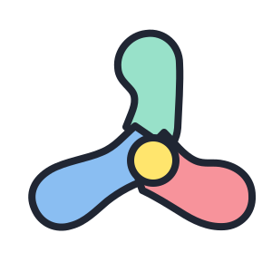

<div align="center">
  
  <h1>JejakTim</h1>
  <p><strong>Ruang kerja sederhana untuk tugas kelompok mahasiswa.</strong></p>
  <p>Catat tugas, lihat progres, beri review, dan simpan jejak kerja tim dalam satu tempat.</p>

  <a href="https://flutter.dev"></a>
  <a href="https://dart.dev"></a>
  <a href="https://github.com/OrganicoconutSugar/JejakTim"></a>
</div>

## JejakTim itu apa?

JejakTim adalah aplikasi kolaborasi untuk kelompok mahasiswa. Aplikasi ini membantu tim membagi tugas dengan jelas, memperbarui progres, mengirim bukti pekerjaan, dan melakukan review tanpa harus berpindah-pindah aplikasi.

Nama **JejakTim** dipilih karena setiap langkah kerja tim tetap tercatat dan mudah dilihat kembali. Logo tiga jalur berwarna yang bertemu melambangkan beberapa orang yang bergerak dengan peran berbeda, lalu menyatukan hasilnya di satu tujuan.

## Yang bisa dicoba

- Masuk dengan **demo lokal** tanpa akun cloud.
- Buat proyek dan bagikan kode undangan ke anggota.
- Buat tugas, tentukan penanggung jawab dan reviewer.
- Catat pembaruan, kirim submission, minta revisi, lalu setujui hasil.
- Lihat Insight tim dan buat laporan proyek dalam PDF.
- Gunakan onboarding bergambar, logo animasi, video pembuka, dan navigasi yang ramah untuk mobile.

## User flow

1. Pengguna membuka aplikasi dan melihat video pembuka JejakTim selama beberapa detik.
2. Pengguna baru membaca onboarding singkat tentang cara kerja aplikasi.
3. Pengguna masuk atau memilih **Jelajahi demo lokal**.
4. Pengguna membuat proyek, mengisi informasi dasar, lalu mendapatkan kode undangan.
5. Anggota lain memasukkan kode tersebut dan bergabung ke proyek.
6. Ketua membuat tugas, memilih anggota yang mengerjakan, dan memilih reviewer.
7. Anggota mengerjakan tugas, menambahkan update, lalu mengirim bukti atau tautan pekerjaan.
8. Reviewer memberi persetujuan atau meminta revisi. Setelah beberapa tugas tercatat, tim dapat membuka Insight dan membuat laporan.

## Teknologi yang digunakan

| Bagian | Teknologi |
| --- | --- |
| Aplikasi | Flutter dan Dart |
| Tampilan | Material 3, custom design tokens, Outfit dan Roboto |
| Navigasi | `go_router` |
| State | Riverpod |
| Data demo | Repository lokal dengan penyimpanan perangkat |
| Backend opsional | Firebase Auth/Firestore/Functions atau Supabase |
| Media | `video_player`, SVG, PDF dan printing |

## Menjalankan di komputer

Pastikan Flutter sudah terpasang, kemudian:

```bash
cd app
flutter pub get
flutter run -d chrome
```

Untuk menjalankan di Android:

```bash
cd app
flutter run
```

Mode demo lokal dapat langsung dipakai tanpa Firebase cloud. Integrasi Firebase emulator dan Supabase dijelaskan lebih lengkap di [README aplikasi](app/README.md) dan dokumentasi SQL di folder [`supabase/`](supabase/).

## Struktur singkat

```text
app/                 Aplikasi Flutter (UI, routing, repository, test)
app/assets/          Logo, ilustrasi, ikon, font, dan video pembuka
functions/            Callable backend Firebase dan validasi input
supabase/             Skema dan fungsi database Supabase
firestore.rules       Aturan akses Firestore
storage.rules         Aturan akses Storage
docs/                 Asset identitas JejakTim untuk dokumentasi
```

## Status proyek

JejakTim saat ini siap dijalankan sebagai demo lokal dan dapat diuji di browser maupun Android. Firebase cloud, provider AI, App Check, release signing, dan distribusi produksi belum diaktifkan. Batas ini sengaja ditulis agar kontribusi berikutnya mudah dipahami dan tidak ada fitur yang dianggap sudah online padahal belum dikonfigurasi.

## Ingin ikut berkolaborasi?

1. Fork repository ini.
2. Buat branch kecil dengan nama yang jelas, misalnya `feat/task-filter`.
3. Jalankan `flutter analyze` dan `flutter test` sebelum membuat pull request.
4. Jelaskan perubahan dengan bahasa sederhana dan sertakan screenshot jika mengubah tampilan.

Ide, laporan bug, dan pull request sangat terbuka. Silakan mulai dari [Issues](https://github.com/OrganicoconutSugar/JejakTim/issues).

<div align="center">
  <sub>Dibuat dengan Flutter untuk membantu tim mahasiswa bekerja lebih rapi.</sub>
</div>
